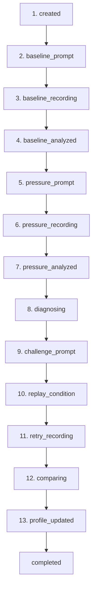
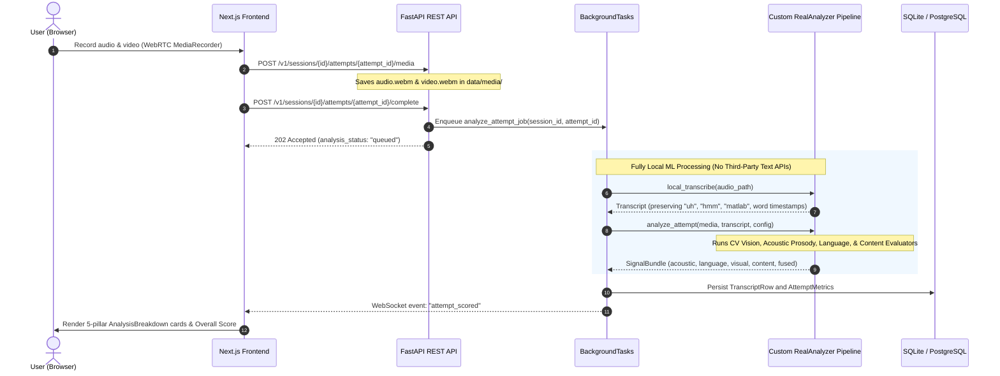

# Pitchground: ML Architecture & Technical Specification

> **Consolidated Document 1 of 2**  
> Covers: End-to-End System Analysis, Architectural Boundaries, Merge-Conflict Prevention Strategy, and In-Depth Technical Specifications for all 3 Custom Local ML Models.

---

## 1. End-to-End System Analysis & Data Flow

Pitchground is an **adaptive communication training platform** that diagnoses and trains communication performance under pressure (technical interviews, debates, impromptu speaking).

### The 13-Step P0 State Machine
The system executes a strictly sequential, lockstep state machine driven by `SessionOrchestrator`:


1. **Baseline Phase:** The user records an unpressured response to establish their personal calibration baseline (`BaselineVector`).
2. **Pressure Phase:** The system introduces controlled pressure (a strict 20-second timer or an interruption).
3. **Detection & Diagnosis Phase:** Multimodal signals from the pressure take are compared against baseline ($z\text{-delta}$). Meaningful deterioration triggers evidence creation and candidate failure classification (`freeze`, `fluency_breakdown`, `language_instability`, `knowledge_gap`, `delivery_collapse`, `ramble`).
4. **Targeted Challenge & Replay:** The system crafts an adaptive challenge with the same pressure condition to practice recovery.
5. **Comparison & Improvement:** The retry take is analyzed and compared against the pressure take (`improved | unchanged | worsened`).
6. **State Persistence:** Learner dimension scores update via Exponential Moving Average (EMA) and append to profile snapshots.

### End-to-End Media & Inference Flow


---

## 2. Zero-Merge-Conflict Architecture Design

To ensure you can develop, modify, and deploy ML models without encountering git merge conflicts when teammates push backend or frontend changes, the ML system is engineered with strict boundary isolation:

```
pitchground/
├── backend/app/
│   ├── ml/                     <-- [ISOLATED ML SANDBOX - 100% OWNED BY YOU]
│   │   ├── types.py            # Static schema contract (SignalBundle)
│   │   ├── protocols.py        # Static protocol definition
│   │   ├── factory.py          # Existing plug-in router (Only touches 1 line)
│   │   ├── local_transcriber.py# [NEW] Local Faster-Whisper verbatim model
│   │   ├── acoustic.py         # [NEW] Audio prosody & speaking score
│   │   ├── language.py         # [NEW] English & Hindi filler parser
│   │   ├── vision.py           # [NEW] Computer Vision & Stress model
│   │   ├── content.py          # [NEW] Local semantic coverage model
│   │   └── real_analyzer.py    # [NEW] Coordinator returning SignalBundle
│   │
│   ├── orchestration/          # Untouched (Teammate owned)
│   ├── api/                    # Untouched (Teammate owned)
│   ├── services/               # Untouched (Teammate owned)
│   └── models/                 # Untouched (Teammate owned)
```

### 4 Rules Guaranteeing Zero Conflicts:
1. **Never edit files outside `app/ml/`:** Core orchestrator logic (`orchestrator.py`, `state_machine.py`, `entities.py`) treats ML as a black box. You never need to touch them.
2. **Factory Dynamic Hook:** [`app/ml/factory.py`](file:///c:/Users/SURESH%20D%20KOTADIA/Desktop/cs/projects/pitchground/backend/app/ml/factory.py) is already programmed to import `RealAnalyzer` automatically when `ML_ANALYZER=real`.
3. **Environment-Driven Activation:** You toggle your model in your local `.env` file (`ML_ANALYZER=real`). `.env` is in `.gitignore`, so your local configuration will never collide with git commits.
4. **Immutable Output Contract:** As long as your `real_analyzer.py` returns the standard `SignalBundle` object defined in [`types.py`](file:///c:/Users/SURESH%20D%20KOTADIA/Desktop/cs/projects/pitchground/backend/app/ml/types.py), the detector, database, and Next.js frontend will consume your real metrics without code changes.

---

## 3. Model 1 Specification: Custom CV Camera & Stress Model

### Objective
Process learner video (`video_path`, WebM format) offline at **5 FPS** on local CPU to calculate eye contact, head tilt, physical freezing, gesture energy, and a composite **Visual Stress Score**.

### Technology Stack
- `mediapipe` (Face Mesh + Upper Body Pose + Hands) & `opencv-python-headless`.
- Processing speed: ~1.5 seconds for a 30-second video on standard CPU (no GPU required).

### Key Metrics & Algorithms
1. **Eye Gaze & Camera Contact (`gaze_away`):**
   - Tracks iris landmarks (468–477) relative to inner/outer eye corners (33, 133).
   - If iris horizontal offset deviates outside the center band ($0.32 - 0.68$), the frame is tagged as looking away.
   - Output: $\text{gaze\_away} = \frac{N_{\text{diverted\_frames}}}{N_{\text{total\_sampled}}} \in [0.0, 1.0]$.
2. **Head Tilt & Slouching (`head_down`):**
   - Vertical distance ratio between chin (landmark 152) and nose tip (landmark 1).
   - Flags posture collapse or staring down under pressure.
3. **Body Immobility & Freeze Ratio (`freeze_ratio`):**
   - Frame-to-frame Euclidean landmark displacement across upper-body pose joints:
     $$\Delta_{\text{motion}}(t) = \frac{1}{K}\sum_{k=1}^K \|\mathbf{p}_k(t) - \mathbf{p}_k(t-1)\|$$
   - A frame is classified as "frozen" if $\Delta_{\text{motion}}(t) < 0.003$.
   - Output: $\text{freeze\_ratio} = \frac{N_{\text{frozen\_frames}}}{N_{\text{total\_frames}}} \in [0.0, 1.0]$.
4. **Hand Gestures & Nervous Leakage (`gesture_energy`):**
   - Measures hand landmark velocity. Detects nervous face/neck touching and fidgeting.
5. **Composite Visual Stress Score ($0-100$):**
   $$\text{Stress Score} = 100 \times \left(0.35 \cdot \text{gaze\_away} + 0.25 \cdot \text{head\_down} + 0.25 \cdot \text{freeze\_ratio} + 0.15 \cdot \max(0.0, 0.5 - \text{gesture\_energy})\right)$$
   - Healthy range: $10 - 35$
   - Elevated stress: $36 - 65$
   - Severe non-verbal breakdown: $> 65$

---

## 4. Model 2 Specification: Custom Local Verbatim STT & Acoustic Model

### Why Third-Party Text APIs Fail for Communication Training
Cloud STT APIs apply text normalization algorithms that explicitly suppress speech disfluencies, hesitations, and false starts (`"uh"`, `"umm"`, `"ahh"`, `"hmm"`) to produce polished reading text. In Pitchground, **hesitation tokens and fillers are the primary indicators of panic and delivery breakdown**.

### Local Verbatim Engine Architecture
- **Engine:** `faster-whisper` (`base.en` or `small` with CTranslate2 `int8` quantization running locally on CPU).
- **Verbatim Parameter Configuration:**
  - `initial_prompt="Um, uh, ahh, hmm, like, you know, actually, basically, err..."`: Primes the model's language decoder to assign high probability to hesitation tokens.
  - `suppress_tokens=[]`: Clears the default token suppression list that strips disfluencies.
  - `word_timestamps=True`: Yields precise start and end timestamps for every spoken word and hesitation.

### Multilingual Filler Detection
- **English Fillers:** `"um"`, `"uh"`, `"ahh"`, `"er"`, `"hmm"`, `"like"`, `"you know"`, `"actually"`, `"basically"`, `"so yeah"`, `"i mean"`, `"sort of"`.
- **Hindi / Hinglish Fillers:** `"मतलब" (matlab)`, `"यार" (yaar)`, `"वो" (woh)`, `"अरे" (arre)`, `"हम्म" (hmmm)`, `"अच्छा" (achha)`, `"मतलब की" (matlab ki)`.
- **Filler Rate:**
  $$\text{filler\_rate} = \frac{N_{\text{fillers}}}{N_{\text{total\_words}}} \times 100 \quad (\text{fillers per 100 words})$$

### Acoustic Prosody (`librosa`)
1. **Speaking Rate (`wpm`):**
   $$\text{WPM} = \frac{N_{\text{words}}}{\text{Active Speech Duration (minutes)}}$$
2. **Pause Ratio & Silence Bursts (`pause_ratio`, `silence_burst_count`):**
   - Voice Activity Detection (VAD) via top-dB thresholding calculates silence ratio.
   - Silence Bursts: Counts all hesitation gaps $\ge 700\text{ ms}$.
3. **Pitch & Energy Variance (`pitch_var`, `energy_var`):**
   - $F_0$ pitch contour standard deviation via probabilistic Yin (detecting flat monotone vs nervous vocal tremor).
   - RMS energy standard deviation (detecting fading volume under pressure).
4. **Composite Speaking Score ($0-100$):**
   $$\text{Speaking Score} = \max(0, \min(100, 100 - (12 \cdot \max(0, \text{filler\_rate} - 2) + 40 \cdot \text{pause\_ratio} + 0.35 \cdot |\text{wpm} - 135|)))$$

---

## 5. Model 3 Specification: Multimodal Fusion & Improvement Engine

### Objective
Fuse vision, acoustic, language, and content features into normalized dimensional scores, compare observed pressure performance against the learner's personal baseline using Z-score deltas, detect failure conditions, and generate actionable improvement recommendations.

### The 6 Fused Dimensions ($0.0 - 1.0$)
1. **`fluency`:** Speaking pace (WPM), continuity (inverse pause ratio), and filler penalties.
2. **`composure`:** Voice stability (inverse energy variance) and physical stillness (inverse freeze ratio).
3. **`presence`:** Eye contact (inverse gaze away) and natural gesture energy.
4. **`structure`:** Discourse coherence and logical sequencing.
5. **`language_stability`:** Primary language adherence and absence of unintended code-switching.
6. **`content`:** Semantic key-point coverage and specificity.

### Local Semantic Content Coverage
Uses `sentence-transformers/all-MiniLM-L6-v2` locally on CPU (80MB footprint):
$$\text{coverage} = \frac{1}{|K|} \sum_{k \in K} \mathbb{I}\left(\max_{s \in \text{sentences}} \text{cosine\_sim}(s, k) \ge 0.62\right)$$

### Failure Condition Classification
| Failure Condition | Mathematical Trigger Pattern |
|---|---|
| `freeze` | $\Delta \text{pause\_ratio} \ge 0.15$ OR $\text{freeze\_ratio} \ge 0.20$ |
| `fluency_breakdown` | $\Delta \text{filler\_rate} \ge 2.5$ OR $\Delta \text{wpm} \le -25$ |
| `language_instability` | $\Delta \text{code\_switch\_rate} \ge 0.20$ OR $\Delta \text{primary\_ratio} \le -0.15$ |
| `knowledge_gap` | $\Delta \text{coverage} \le -0.20$ while fluency remains steady |
| `delivery_collapse` | Fluency and composure drop $> 25\%$ while content coverage stays stable |
| `ramble` | Word count increases $> 40\%$ with low structure score |

### Actionable Coaching Recommendation Engine
For each diagnosed failure, the engine generates concrete behavioral feedback:
- **Fluency Breakdown:** *"Replace vocal fillers ('um', 'uh') with deliberate 1-second silent pauses to collect thoughts; adopt the PREP framework."*
- **Freeze:** *"Take a full exhale before answering; state your core definition in the very first sentence."*
- **Ramble:** *"Limit each response point to 2 sentences: one key claim, one concrete example."*
