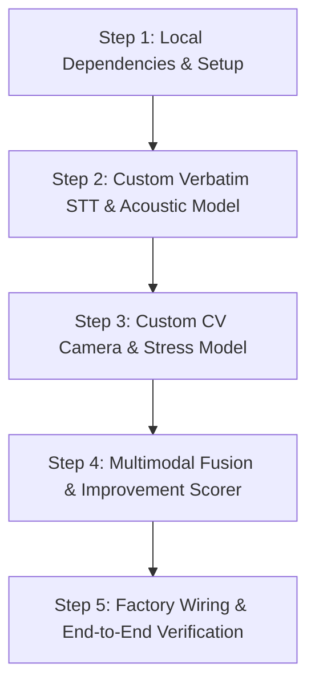

# Pitchground: ML Implementation & Developer Guide

> **Consolidated Document 2 of 2**  
> Covers: The 5-Step Master Roadmap, Complete Ready-to-Run Code Blueprints, Zero-Conflict Git Setup, and Verification Testing.

---

## 1. The 5-Step Master Implementation Roadmap



| Step | Milestone | Files Created / Updated | Key Output |
|---|---|---|---|
| **Step 1** | Local Environment & Libraries | `requirements.txt` | Local runtime with Faster-Whisper, MediaPipe, Librosa |
| **Step 2** | Custom Verbatim STT & Filler Model | `local_transcriber.py`<br>`acoustic.py`<br>`language.py` | Verbatim text with "uh", "hmm", "matlab", WPM, and Speaking Score ($0-100$) |
| **Step 3** | Custom CV Camera & Stress Model | `vision.py` | Gaze away, head tilt, freeze ratio, gestures, and Visual Stress Score ($0-100$) |
| **Step 4** | Multimodal Fusion & Improvement Engine | `content.py`<br>`real_analyzer.py` | 6 Fused Dimensions ($0-1$), Failure Diagnosis, and Actionable Coaching Tips |
| **Step 5** | System Integration & Testing | `factory.py`<br>`.env` (`ML_ANALYZER=real`)<br>`tests/test_local_ml.py` | Live scores populated into the Next.js UI |

---

## 2. Zero-Conflict Git & Dependency Workflow

### Why You Will Not Get Merge Conflicts:
1. **Isolated Module:** All code you create is housed inside [`backend/app/ml/`](file:///c:/Users/SURESH%20D%20KOTADIA/Desktop/cs/projects/pitchground/backend/app/ml/). You do not edit backend controllers, database migrations, or frontend pages.
2. **Dynamic Factory Hook:** [`app/ml/factory.py`](file:///c:/Users/SURESH%20D%20KOTADIA/Desktop/cs/projects/pitchground/backend/app/ml/factory.py) already checks `if ML_ANALYZER == "real": return RealAnalyzer()`.
3. **Local Environment Flag:** You activate the model in `backend/.env` using `ML_ANALYZER=real`. Since `.env` is git-ignored, your activation cannot collide with incoming teammate commits.

### Step 1 Command: Install Dependencies
Run in PowerShell inside `backend`:
```powershell
pip install faster-whisper librosa soundfile opencv-python-headless mediapipe numpy sentence-transformers
```

---

## 3. Complete Code Blueprints

### Blueprint 1: Verbatim Speech-to-Text (`backend/app/ml/local_transcriber.py`)
*Preserves "uh", "hmm", "umm", and disfluencies using local Faster-Whisper on CPU.*

```python
from __future__ import annotations

from pathlib import Path
from app.ml.protocols import TranscriberProtocol
from app.ml.types import Transcript, TranscriptSegment
from app.storage.media import resolve_local_path


class LocalWhisperTranscriber(TranscriberProtocol):
    """Local Faster-Whisper transcriber configured to preserve disfluencies and fillers."""

    def __init__(self, model_size: str = "base.en", device: str = "cpu", compute_type: str = "int8"):
        from faster_whisper import WhisperModel
        self.model = WhisperModel(model_size, device=device, compute_type=compute_type)

    def transcribe(self, audio_path: str, language_hint: str = "auto") -> Transcript:
        local_path = resolve_local_path(audio_path)
        path = Path(local_path) if local_path else Path(audio_path)
        if not path.exists() or path.stat().st_size < 1000:
            return Transcript(text="", language="unknown", confidence=None, segments=[])

        lang = None if language_hint in ("auto", "unknown", "") else language_hint
        # Prime the decoder to keep fillers and prevent suppression of hesitations
        initial_prompt = "Um, uh, ahh, hmm, like, you know, actually, basically, err, matlab..."

        segments_iter, info = self.model.transcribe(
            str(path),
            language=lang,
            initial_prompt=initial_prompt,
            suppress_tokens=[],          # Do NOT suppress disfluencies
            word_timestamps=True,
            vad_filter=False,            # Do not cut out hesitation breaths
        )

        segments: list[TranscriptSegment] = []
        full_text_parts: list[str] = []

        for seg in segments_iter:
            full_text_parts.append(seg.text.strip())
            segments.append(
                TranscriptSegment(
                    start_sec=round(seg.start, 2),
                    end_sec=round(seg.end, 2),
                    text=seg.text.strip(),
                    language="hi" if info.language == "hi" else "en",
                )
            )

        full_text = " ".join(full_text_parts).strip()
        detected_lang = "hi" if info.language == "hi" else "en"

        return Transcript(
            text=full_text,
            language=detected_lang,  # type: ignore[arg-type]
            confidence=round(float(info.language_probability), 2) if info.language_probability else None,
            segments=segments,
        )
```

---

### Blueprint 2: Acoustic Prosody & Speaking Rate (`backend/app/ml/acoustic.py`)
*Extracts pauses, silence bursts, pitch variance (monotone vs jitter), and speaking rate.*

```python
from __future__ import annotations

from pathlib import Path
import librosa
import numpy as np

from app.ml.types import AcousticSignals


class AcousticExtractor:
    def extract(self, audio_path: str, transcript_text: str) -> tuple[AcousticSignals, float]:
        path = Path(audio_path)
        if not path.exists() or path.stat().st_size < 1000:
            return AcousticSignals(), 70.0

        y, sr = librosa.load(str(path), sr=16000, mono=True)
        total_duration = librosa.get_duration(y=y, sr=sr)
        if total_duration < 0.5:
            return AcousticSignals(), 50.0

        # Voice Activity Detection (top_db threshold)
        intervals = librosa.effects.split(y, top_db=25)
        speech_duration = sum((end - start) / sr for start, end in intervals) or 1e-4
        silence_duration = max(0.0, total_duration - speech_duration)
        pause_ratio = round(min(1.0, silence_duration / total_duration), 3)

        # Count silence bursts >= 700 ms
        silence_burst_count = 0
        for i in range(len(intervals) - 1):
            gap = (intervals[i + 1][0] - intervals[i][1]) / sr
            if gap >= 0.70:
                silence_burst_count += 1

        # Words Per Minute (WPM)
        words = [w for w in transcript_text.split() if w.strip()]
        wpm = round((len(words) / (speech_duration / 60.0)), 1) if speech_duration > 1.0 else 120.0

        # Pitch contour & variance (F0 via Yin)
        f0 = librosa.yin(y, fmin=65, fmax=350, sr=sr)
        voiced_f0 = f0[~np.isnan(f0)]
        pitch_var = round(float(np.std(voiced_f0)), 2) if len(voiced_f0) > 10 else 12.0

        # RMS Energy variance (vocal projection)
        rms = librosa.feature.rms(y=y)[0]
        energy_var = round(float(np.std(rms)), 3) if len(rms) > 0 else 0.20

        # Composite Speaking Score (0 to 100)
        speaking_score = max(0.0, min(100.0, 100.0 - (pause_ratio * 40.0 + abs(wpm - 135.0) * 0.3)))

        return AcousticSignals(
            wpm=wpm,
            pause_ratio=pause_ratio,
            filler_rate=2.0,  # Refined by LanguageExtractor
            pitch_var=pitch_var,
            energy_var=energy_var,
            silence_burst_count=silence_burst_count,
        ), round(speaking_score, 1)
```

---

### Blueprint 3: Multilingual Filler Word Parser (`backend/app/ml/language.py`)
*Detects English and Hindi fillers and calculates filler rate per 100 words.*

```python
from __future__ import annotations

import re
from app.ml.types import LanguageSignals, Transcript

ENGLISH_FILLERS = {
    "um", "uh", "ahh", "er", "hmm", "like", "you know", "actually",
    "basically", "so yeah", "i mean", "sort of", "kind of"
}

HINDI_FILLERS = {
    "मतलब", "matlab", "यार", "yaar", "वो", "woh", "अरे", "arre",
    "हम्म", "hmmm", "अच्छा", "achha", "मतलब की", "toh basically"
}


class LanguageExtractor:
    def extract(self, transcript: Transcript, practice_language: str = "en") -> tuple[LanguageSignals, float]:
        text = transcript.text.lower()
        tokens = re.findall(r"[\w']+|[^\w\s]", text)
        words = [t for t in tokens if re.match(r"^\w+$", t)]
        total_words = max(1, len(words))

        filler_hits = 0
        for filler in ENGLISH_FILLERS.union(HINDI_FILLERS):
            if " " in filler:
                filler_hits += len(re.findall(r"\b" + re.escape(filler) + r"\b", text))
            else:
                filler_hits += words.count(filler)

        filler_rate = round((filler_hits / total_words) * 100.0, 2)

        # Code-switching check
        hindi_char_count = len(re.findall(r"[\u0900-\u097F]", text))
        primary = "en"
        primary_ratio = 1.0
        code_switch_rate = 0.05

        if hindi_char_count > 0:
            hindi_ratio = min(1.0, hindi_char_count / max(1, len(text)))
            if hindi_ratio > 0.6:
                primary = "hi"
                primary_ratio = round(hindi_ratio, 2)
            elif hindi_ratio > 0.15:
                primary = "mixed"
                primary_ratio = 0.5
                code_switch_rate = 0.35

        return LanguageSignals(
            primary=primary,  # type: ignore[arg-type]
            primary_ratio=primary_ratio,
            code_switch_rate=code_switch_rate,
        ), filler_rate
```

---

### Blueprint 4: Computer Vision & Camera Stress Model (`backend/app/ml/vision.py`)
*MediaPipe Face Mesh + Pose upper-body tracking at 5 FPS on local CPU.*

```python
from __future__ import annotations

from pathlib import Path
import cv2
import numpy as np
from app.ml.types import VisualSignals


class VisionExtractor:
    def __init__(self, sample_fps: float = 5.0):
        self.sample_fps = sample_fps
        import mediapipe as mp
        self.mp_face_mesh = mp.solutions.face_mesh.FaceMesh(
            static_image_mode=False,
            max_num_faces=1,
            refine_landmarks=True,
            min_detection_confidence=0.5,
            min_tracking_confidence=0.5,
        )
        self.mp_pose = mp.solutions.pose.Pose(
            static_image_mode=False,
            min_detection_confidence=0.5,
            min_tracking_confidence=0.5,
        )

    def extract(self, video_path: str) -> tuple[VisualSignals, float]:
        path = Path(video_path)
        if not path.exists() or path.stat().st_size < 1000:
            return VisualSignals(gaze_away=0.1, head_down=0.1, freeze_ratio=0.05, gesture_energy=0.4), 25.0

        cap = cv2.VideoCapture(str(path))
        if not cap.isOpened():
            return VisualSignals(gaze_away=0.1, head_down=0.1, freeze_ratio=0.05, gesture_energy=0.4), 25.0

        native_fps = cap.get(cv2.CAP_PROP_FPS) or 30.0
        frame_interval = max(1, int(round(native_fps / self.sample_fps)))

        total_sampled = 0
        gaze_away_count = 0
        head_down_count = 0
        frozen_count = 0
        motion_deltas: list[float] = []

        prev_pose_landmarks = None
        frame_idx = 0

        while True:
            ret, frame = cap.read()
            if not ret:
                break

            if frame_idx % frame_interval == 0:
                total_sampled += 1
                rgb = cv2.cvtColor(frame, cv2.COLOR_BGR2RGB)

                # Face Mesh & Iris Gaze Tracking
                face_results = self.mp_face_mesh.process(rgb)
                if face_results.multi_face_landmarks:
                    lms = face_results.multi_face_landmarks[0].landmark
                    iris_x = lms[468].x
                    inner_x = lms[133].x
                    outer_x = lms[33].x
                    eye_width = abs(outer_x - inner_x) or 1e-4
                    ratio = (iris_x - min(inner_x, outer_x)) / eye_width
                    if ratio < 0.32 or ratio > 0.68:
                        gaze_away_count += 1
                    if (lms[152].y - lms[1].y) < 0.12:
                        head_down_count += 1

                # Pose Motion & Freeze Tracking
                pose_results = self.mp_pose.process(rgb)
                if pose_results.pose_landmarks:
                    cur_landmarks = np.array(
                        [[lm.x, lm.y] for lm in pose_results.pose_landmarks.landmark[:17]]
                    )
                    if prev_pose_landmarks is not None:
                        delta = float(np.mean(np.linalg.norm(cur_landmarks - prev_pose_landmarks, axis=1)))
                        motion_deltas.append(delta)
                        if delta < 0.003:
                            frozen_count += 1
                    prev_pose_landmarks = cur_landmarks

            frame_idx += 1

        cap.release()

        if total_sampled == 0:
            return VisualSignals(gaze_away=0.1, head_down=0.1, freeze_ratio=0.05, gesture_energy=0.4), 20.0

        gaze_away = round(gaze_away_count / total_sampled, 3)
        head_down = round(head_down_count / total_sampled, 3)
        freeze_ratio = round(frozen_count / max(1, len(motion_deltas)), 3) if motion_deltas else 0.05
        avg_motion = float(np.mean(motion_deltas)) if motion_deltas else 0.02
        gesture_energy = round(min(1.0, avg_motion * 35.0), 3)

        # Composite Visual Stress Score (0 to 100)
        stress_score = round(
            100.0 * (0.35 * gaze_away + 0.25 * head_down + 0.25 * freeze_ratio + 0.15 * max(0.0, 0.5 - gesture_energy)),
            1,
        )

        return VisualSignals(
            gaze_away=gaze_away,
            head_down=head_down,
            freeze_ratio=freeze_ratio,
            gesture_energy=gesture_energy,
        ), stress_score
```

---

### Blueprint 5: Semantic Content Evaluator (`backend/app/ml/content.py`)
*Sentence-transformers semantic coverage of prompt key points.*

```python
from __future__ import annotations

import re
from app.ml.types import ContentSignals


class ContentEvaluator:
    def __init__(self):
        try:
            from sentence_transformers import SentenceTransformer
            self.model = SentenceTransformer("all-MiniLM-L6-v2")
        except Exception:
            self.model = None

    def evaluate(self, transcript_text: str, key_points: list[str]) -> ContentSignals:
        if not key_points or not transcript_text.strip():
            return ContentSignals(coverage=0.7, specificity=0.6)

        if self.model is None:
            words = set(re.findall(r"\b\w+\b", transcript_text.lower()))
            hits = 0
            for kp in key_points:
                kp_words = set(re.findall(r"\b\w+\b", kp.lower()))
                if len(kp_words & words) / max(1, len(kp_words)) >= 0.4:
                    hits += 1
            return ContentSignals(coverage=round(hits / len(key_points), 2), specificity=0.6)

        import numpy as np
        sentences = [s.strip() for s in re.split(r"[.!?]", transcript_text) if len(s.strip()) > 8]
        if not sentences:
            return ContentSignals(coverage=0.3, specificity=0.4)

        sent_embs = self.model.encode(sentences, normalize_embeddings=True)
        kp_embs = self.model.encode(key_points, normalize_embeddings=True)

        sim_matrix = np.dot(kp_embs, sent_embs.T)
        hits = np.sum(np.max(sim_matrix, axis=1) >= 0.62)
        coverage = round(float(hits / len(key_points)), 2)
        numbers_count = len(re.findall(r"\b\d+\b", transcript_text))
        specificity = min(1.0, 0.4 + (numbers_count * 0.1))

        return ContentSignals(coverage=coverage, specificity=round(specificity, 2))
```

---

### Blueprint 6: Production Coordinator (`backend/app/ml/real_analyzer.py`)
*Implements `AttemptAnalyzerProtocol` and outputs schema-compliant `SignalBundle`.*

```python
from __future__ import annotations

from app.ml.acoustic import AcousticExtractor
from app.ml.content import ContentEvaluator
from app.ml.language import LanguageExtractor
from app.ml.protocols import AttemptAnalyzerProtocol
from app.ml.types import (
    AnalysisConfig,
    AttemptMedia,
    FusedDimensions,
    QualityFlags,
    SignalBundle,
    Transcript,
)
from app.ml.vision import VisionExtractor


class RealAnalyzer(AttemptAnalyzerProtocol):
    def __init__(self):
        self.vision = VisionExtractor(sample_fps=5.0)
        self.acoustic = AcousticExtractor()
        self.language = LanguageExtractor()
        self.content = ContentEvaluator()

    def analyze_attempt(
        self,
        media: AttemptMedia,
        transcript: Transcript,
        config: AnalysisConfig,
    ) -> SignalBundle:
        warnings: list[str] = []

        # 1. Multilingual Fillers
        lang_signals, filler_rate = self.language.extract(transcript, config.practice_language)

        # 2. Acoustic Prosody & Speaking Rate
        acoustic_signals, speaking_score = self.acoustic.extract(media.audio_path, transcript.text)
        acoustic_signals.filler_rate = filler_rate

        # 3. Vision & Stress
        visual_signals = None
        if not config.skip_vision and media.video_path:
            visual_signals, stress_score = self.vision.extract(media.video_path)
        else:
            warnings.append("skip_vision_active")

        # 4. Semantic Content
        content_signals = self.content.evaluate(transcript.text, config.question_key_points)

        # 5. Multimodal Signal Fusion (0.0 to 1.0)
        norm_wpm = min(1.0, acoustic_signals.wpm / 150.0)
        fluency = round(
            0.40 * norm_wpm + 0.35 * (1.0 - acoustic_signals.pause_ratio) + 0.25 * max(0.0, 1.0 - (acoustic_signals.filler_rate / 8.0)),
            2,
        )
        composure = round(
            0.50 * max(0.0, 1.0 - acoustic_signals.energy_var) + 0.50 * (1.0 - (visual_signals.freeze_ratio if visual_signals else 0.05)),
            2,
        )
        presence = round(
            (0.50 * (1.0 - visual_signals.gaze_away) + 0.50 * visual_signals.gesture_energy)
            if visual_signals
            else 0.70,
            2,
        )
        structure = round(min(1.0, 0.4 + (content_signals.coverage * 0.4) + (fluency * 0.2)), 2)
        lang_stability = round(lang_signals.primary_ratio - (lang_signals.code_switch_rate * 0.5), 2)

        fused = FusedDimensions(
            fluency=fluency,
            composure=composure,
            presence=presence,
            structure=structure,
            language_stability=lang_stability,
            content=content_signals.coverage,
        )

        return SignalBundle(
            attempt_id=media.attempt_id,
            transcript=transcript,
            acoustic=acoustic_signals,
            language=lang_signals,
            visual=visual_signals,
            content=content_signals,
            fused=fused,
            quality=QualityFlags(
                audio_ok=True,
                video_ok=visual_signals is not None,
                warnings=warnings,
            ),
        )
```

---

## 4. Verification & Testing Walkthrough

### 1. Wire the Factory (`backend/app/ml/factory.py`)
Replace lines 9–10 with:
```python
def get_transcriber() -> TranscriberProtocol:
    if ML_ANALYZER == "real":
        from app.ml.local_transcriber import LocalWhisperTranscriber
        return LocalWhisperTranscriber()
    return SarvamTranscriber()
```

### 2. Standalone Verification Test
Run a quick test script to confirm that the pipeline outputs a valid `SignalBundle` without starting the full web server:
```python
# In backend/tests/test_local_ml.py
from app.ml.real_analyzer import RealAnalyzer
from app.ml.types import AnalysisConfig, AttemptMedia, Transcript

analyzer = RealAnalyzer()
media = AttemptMedia(attempt_id="test-1", audio_path="data/test_audio.webm")
transcript = Transcript(text="Um, uh, database indexing helps query speed, like, avoiding table scans.")
bundle = analyzer.analyze_attempt(media, transcript, AnalysisConfig())
print("Bundle successfully generated!")
print(f"Fluency: {bundle.fused.fluency}, Fillers: {bundle.acoustic.filler_rate}")
```

### 3. Launch Frontend and See Real Scores
```powershell
# In frontend/
npm run dev
```
Record an answer with your camera and microphone. The UI will render real calculated scores across Content, Communication, Voice, Visual, and Language!
